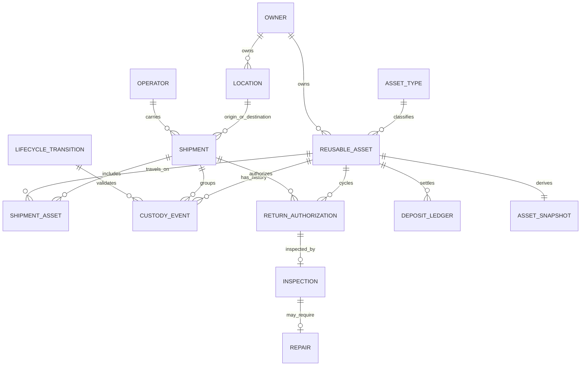

# Data Dictionary and Entity Relationships

## Conventions and lifecycle assumptions

- Every timestamp is ISO-8601 UTC with an explicit `+00:00` offset. The data is simulated through the as-of date `2026-11-07`; no event or transaction is later than that date.
- Integer amounts are USD cents. Day counts are whole calendar days. Booleans are exported as `true`/`false` in CSV and JSON.
- Master rows (`AssetType`, `Owner`, `Location`, `Operator`) are static reference data for this synthetic snapshot. They do not have effective dates. Operational timestamps are effective occurrence/posting times.
- All IDs are immutable and deterministic for a fixed seed and profile. Uniqueness means primary key or a field explicitly marked unique below.
- `required` means non-null. A nullable field is optional. CSV empty values represent null.
- Validation is performed independently against exported CSVs; `ground_truth.csv` is read only after operational findings are calculated.

## Entities and field rules

### AssetType — `asset_types`

| Field | Type | Required | Allowed values / unit | Unique | Validation |
|---|---|---:|---|---:|---|
| `asset_type_id` | string | Yes | `ATYPE-NNN` | PK | Matches `^ATYPE-\d{3}$`. |
| `name` | string | Yes | Non-empty | Yes | Distinct asset type name. |
| `deposit_cents` | integer | Yes | USD cents | No | Greater than zero. |
| `replacement_cost_cents` | integer | Yes | USD cents | No | Greater than zero. |
| `return_window_days` | integer | Yes | Calendar days | No | Greater than zero; RMA due date is dispatch date plus this window. |
| `loss_threshold_days` | integer | Yes | Calendar days | No | 60–120 days after the due date; loss event is due date + threshold exactly. |
| `late_fee_cents_per_day` | integer | Yes | USD cents/day | No | Non-negative; late fee is capped at the remaining deposit. |
| `max_cycles` | integer | Yes | Trips | No | Greater than zero; planned cycles cannot exceed it. |
| `repairable` | boolean | Yes | `true`, `false` | No | A damaged repairable asset may enter repair; otherwise damage is quarantined. |
| `inspection_required` | boolean | Yes | `true`, `false` | No | Controls whether a returned asset receives an inspection. |

### Owner — `owners`

| Field | Type | Required | Allowed values / unit | Unique | Validation |
|---|---|---:|---|---:|---|
| `owner_id` | string | Yes | `OWNER-NNN` | PK | Matches `^OWNER-\d{3}$`. |
| `name` | string | Yes | Non-empty | Yes | Distinct owner name. |
| `owner_type` | enum | Yes | `SUPPLIER`, `POOL_OPERATOR`, `CUSTOMER` | No | Must match schema enum. |
| `active` | boolean | Yes | `true`, `false` | No | Boolean. |

### Location — `locations`

| Field | Type | Required | Allowed values / unit | Unique | Validation |
|---|---|---:|---|---:|---|
| `location_id` | string | Yes | `LOC-NNN` | PK | Matches `^LOC-\d{3}$`. |
| `name` | string | Yes | Non-empty | Yes | Distinct location name. |
| `location_type` | enum | Yes | `WAREHOUSE`, `CUSTOMER_SITE`, `CARRIER_YARD` | No | Must match schema enum. |
| `region` | string | Yes | Synthetic region code | No | Non-empty. |
| `owner_id` | string | No | `Owner.owner_id` | No | Nullable for third-party carrier locations; otherwise valid owner FK. |

### Operator — `operators`

| Field | Type | Required | Allowed values / unit | Unique | Validation |
|---|---|---:|---|---:|---|
| `operator_id` | string | Yes | `OP-NNN` | PK | Matches `^OP-\d{3}$`. |
| `name` | string | Yes | Non-empty | No | Operator name. |
| `role` | enum | Yes | `PLANNER`, `CARRIER`, `WAREHOUSE_OPERATOR`, `SUPPLIER`, `LOGISTICS_ANALYST`, `OPERATIONS_MANAGER` | No | Must match schema enum. |
| `location_id` | string | Yes | `Location.location_id` | No | Valid location FK. |

### Shipment — `shipments`

| Field | Type | Required | Allowed values / unit | Unique | Validation |
|---|---|---:|---|---:|---|
| `shipment_id` | string | Yes | `SHP-2026-NNNNNN` | PK | Matches `^SHP-2026-\d{6}$`. |
| `owner_id` | string | Yes | `Owner.owner_id` | No | Valid owner FK. |
| `origin_location_id` | string | Yes | `Location.location_id` | No | Valid location FK. |
| `destination_location_id` | string | Yes | `Location.location_id` | No | Valid location FK. |
| `carrier_id` | string | Yes | `Operator.operator_id` | No | Valid operator FK. |
| `dispatched_at` | timestamp | Yes | UTC | No | In 2026 and no later than as-of. |
| `expected_return_at` | timestamp | Yes | UTC | No | Not before dispatch; in 2026 and no later than as-of. |
| `status` | enum | Yes | `IN_TRANSIT`, `PARTIALLY_RETURNED`, `CLOSED`, `LOST` | No | Derived from associated trip outcomes. |

### ReusableAsset — `reusable_assets`

| Field | Type | Required | Allowed values / unit | Unique | Validation |
|---|---|---:|---|---:|---|
| `asset_id` | string | Yes | `ASSET-NNNNNNN` | PK | Matches `^ASSET-\d{7}$`. |
| `asset_type_id` | string | Yes | `AssetType.asset_type_id` | No | Valid asset type FK. |
| `owner_id` | string | Yes | `Owner.owner_id` | No | Valid owner FK. |
| `home_location_id` | string | Yes | `Location.location_id` | No | Valid location FK. |
| `asset_tag` | string | Yes | `TAG-NNNNNNN` | Yes | Unique tag. |
| `created_at` | timestamp | Yes | UTC | No | In 2026 and no later than as-of. |
| `planned_cycles` | integer | Yes | Trips, 1–3 | No | Equals the number of generated RMAs/dispatches and does not exceed AssetType.max_cycles. |

### ShipmentAsset — `shipment_assets` (bridge)

| Field | Type | Required | Allowed values / unit | Unique | Validation |
|---|---|---:|---|---:|---|
| `shipment_id` | string | Yes | `Shipment.shipment_id` | Composite PK | Valid shipment FK. |
| `asset_id` | string | Yes | `ReusableAsset.asset_id` | Composite PK | Valid asset FK. |
| `cycle_number` | integer | Yes | Trip number, 1–3 | Composite PK | Unique asset/cycle pair. |

This bridge models the N:M relationship between shipments and assets over repeat trips; each trip-specific event and transaction must agree with the corresponding bridge row.

### CustodyEvent — `custody_events`

| Field | Type | Required | Allowed values / unit | Unique | Validation |
|---|---|---:|---|---:|---|
| `event_id` | string | Yes | `CUST-<asset-id>-NNNNNN` | PK | `^CUST-ASSET-\d{7}-\d{6}$`, immutable sequence per asset. |
| `asset_id` | string | Yes | `ReusableAsset.asset_id` | No | Valid asset FK. |
| `shipment_id` | string | Yes | `Shipment.shipment_id` | No | Valid shipment FK and bridge relationship. |
| `cycle_number` | integer | Yes | Trip number, 1–3 | No | Matches the trip’s bridge and RMA. |
| `event_type` | enum | Yes | `DISPATCH`, `CUSTODY_HANDOFF`, `CUSTODY_HANDOFF_DISPUTED`, `CUSTODY_DISPUTE_RESOLVED`, `RETURN_DISPATCH`, `RETURN_RECEIVED`, `LOSS_DECLARED`, `CUSTODY_CHECKPOINT` | No | Must have an allowed transition or be a same-location checkpoint. |
| `from_location_id` | string | Yes | `Location.location_id` | No | Valid FK and equals the prior verified location, except a labelled anomaly. |
| `to_location_id` | string | Yes | `Location.location_id` | No | Valid FK. A disputed handoff proposes a destination but does not move location until resolution. |
| `actor_id` | string | No | `Operator.operator_id` | No | Nullable only for the deliberately labelled missing-actor anomaly. |
| `occurred_at` | timestamp | Yes | UTC | No | In 2026, no later than as-of; replay order is `(occurred_at, event_id)`. |

`CUSTODY_CHECKPOINT` is an optional non-moving scan. The generator pads the event volume with these observations only; it never drops a rule-driven event to meet the 100,000-event full-profile target.

### ReturnAuthorization — `return_authorizations`

| Field | Type | Required | Allowed values / unit | Unique | Validation |
|---|---|---:|---|---:|---|
| `rma_id` | string | Yes | `RMA-2026-NNNNNN` | PK | Matches `^RMA-2026-\d{6}$`. |
| `asset_id` | string | Yes | `ReusableAsset.asset_id` | No | Valid asset FK. |
| `shipment_id` | string | Yes | `Shipment.shipment_id` | No | Valid FK and bridge relationship. |
| `cycle_number` | integer | Yes | Trip number, 1–3 | Unique with asset | One RMA per asset cycle. |
| `authorized_at` | timestamp | Yes | UTC | No | In 2026; no later than due date. |
| `expected_return_at` | timestamp | Yes | UTC | No | Dispatch plus asset-type return window. |
| `status` | enum | Yes | `RECEIVED`, `CLOSED_LOST`, `OPEN` | No | Derived from return receipt/loss events. |
| `processed_at` | timestamp | No | UTC | No | Required for `RECEIVED`; absent while open or lost; no later than as-of. |

### Inspection — `inspections`

| Field | Type | Required | Allowed values / unit | Unique | Validation |
|---|---|---:|---|---:|---|
| `inspection_id` | string | Yes | `INSP-2026-NNNNNN` | PK | Matches `^INSP-2026-\d{6}$`. |
| `asset_id` | string | Yes | `ReusableAsset.asset_id` | No | Valid asset FK. |
| `rma_id` | string | Yes | `ReturnAuthorization.rma_id` | Yes | One inspection per RMA; return must be recorded. |
| `cycle_number` | integer | Yes | Trip number, 1–3 | No | Matches the RMA cycle. |
| `inspected_at` | timestamp | Yes | UTC | No | After return receipt and no later than as-of. |
| `condition` | enum | Yes | `GOOD`, `DAMAGED` | No | Seeded synthetic inspection input. |
| `decision` | enum | Yes | `RESTOCK`, `REPAIR`, `QUARANTINE` | No | Good → restock; repairable damage → repair; non-repairable damage → quarantine. |
| `notes` | string | Yes | Synthetic text | No | Non-empty. |

### Repair — `repairs`

| Field | Type | Required | Allowed values / unit | Unique | Validation |
|---|---|---:|---|---:|---|
| `repair_id` | string | Yes | `REP-2026-NNNNNN` | PK | Matches `^REP-2026-\d{6}$`. |
| `asset_id` | string | Yes | `ReusableAsset.asset_id` | No | Valid asset FK. |
| `inspection_id` | string | No | `Inspection.inspection_id` | No | Required for a valid repair; nullable only in the labelled anomaly. |
| `rma_id` | string | Yes | `ReturnAuthorization.rma_id` | Yes | Valid trip RMA. |
| `cycle_number` | integer | Yes | Trip number, 1–3 | No | Matches the RMA cycle. |
| `opened_at` | timestamp | Yes | UTC | No | After inspection; in 2026. |
| `closed_at` | timestamp | No | UTC | No | Null for OPEN; present and not before opened time for CLOSED. |
| `status` | enum | Yes | `OPEN`, `CLOSED` | No | Open work holds settlement; closed work permits settlement. |
| `cost_cents` | integer | Yes | USD cents | No | Non-negative; deterministic synthetic repair cost. |

### DepositLedger — `deposit_ledger`

| Field | Type | Required | Allowed values / unit | Unique | Validation |
|---|---|---:|---|---:|---|
| `ledger_id` | string | Yes | `DLG-2026-NNNNNNNN` | PK | Matches `^DLG-2026-\d{8}$`. |
| `asset_id` | string | Yes | `ReusableAsset.asset_id` | No | Valid asset FK. |
| `shipment_id` | string | Yes | `Shipment.shipment_id` | No | Valid trip shipment and bridge relationship. |
| `rma_id` | string | Yes | `ReturnAuthorization.rma_id` | No | Valid trip RMA. |
| `cycle_number` | integer | Yes | Trip number, 1–3 | No | Matches the trip’s RMA/bridge. |
| `reference_entry_id` | string | No | `DepositLedger.ledger_id` | No | Null for charge; every deduction, forfeiture, or refund references the positive charge. |
| `entry_type` | enum | Yes | `DEPOSIT_CHARGE`, `LATE_FEE_DEDUCTION`, `DAMAGE_DEDUCTION`, `LOSS_FORFEIT`, `DEPOSIT_REFUND` | No | Must match sign/reference rule below. |
| `amount_cents` | integer | Yes | Signed USD cents | No | Charge positive; all settlement entries negative; zero is forbidden. |
| `currency` | enum | Yes | `USD` | No | All generated amounts are US dollars. |
| `posted_at` | timestamp | Yes | UTC | No | In 2026 and no later than as-of; settlement after inspection or repair closure. |

Settlement rules: for a received return, `late_fee = min(days_late × late_fee_cents_per_day, deposit)`. `days_late = max(0, RMA.processed_at date − expected_return_at date)` in whole days. The RMA processing date is the settlement date; custody-event chronology is independently checked and cannot silently rewrite a posted settlement. The damage assessment is repair cost for `REPAIR`, replacement cost for `QUARANTINE`, otherwise zero. `damage_deduction = min(damage_assessment, deposit − late_fee)`. The refund is the remaining deposit after both deductions. Each non-zero deduction/refund is a separate negative row referencing the charge. A loss posts one `LOSS_FORFEIT` for the whole deposit at the threshold. No settlement is posted while an open repair or unresolved custody dispute blocks it. Any damage cost above the deposit is reported as owner-absorbed cost, not a separate owner charge.

### AssetSnapshot — `asset_snapshots`

| Field | Type | Required | Allowed values / unit | Unique | Validation |
|---|---|---:|---|---:|---|
| `asset_id` | string | Yes | `ReusableAsset.asset_id` | PK | One derived snapshot per asset. |
| `current_location_id` | string | Yes | `Location.location_id` | No | Last verified location reconstructed by event replay; not null for loss or dispute. |
| `lifecycle_status` | enum | Yes | `AVAILABLE`, `IN_TRANSIT`, `AT_CUSTOMER`, `CUSTODY_DISPUTED`, `RETURN_IN_TRANSIT`, `OUTSTANDING`, `OVERDUE`, `LOST`, `IN_REPAIR`, `QUARANTINED` | No | Derived from event replay, RMA, inspection, and repair records; never an anomaly sentinel. |
| `current_cycle_number` | integer | Yes | Trip number, 1–3 | No | Latest cycle. |
| `days_outstanding` | integer | Yes | Calendar days | No | Latest cycle dispatch to return/loss or the fixed as-of date for an open trip, floored at zero. |
| `outstanding` | boolean | Yes | `true`, `false` | No | True only when the latest trip has no receipt or loss. |
| `deposit_balance_cents` | integer | Yes | Signed USD cents | No | Exact sum of all immutable ledger rows for the asset. |

### LifecycleTransition — `lifecycle_transitions`

| Field | Type | Required | Allowed values / unit | Unique | Validation |
|---|---|---:|---|---:|---|
| `from_state` | string | Yes | Documented lifecycle state | Composite PK | Must be a state in the transition matrix. |
| `event_type` | enum | Yes | Custody event type | Composite PK | Event must be legal from `from_state`. |
| `to_state` | string | Yes | Documented lifecycle state | Composite PK | Validator applies the transition in timestamp/ID order. |

### GroundTruth — `ground_truth.csv` / `ground_truth.json`

This file is separate from operational input features and is read only after validation.

| Field | Type | Required | Allowed values / unit | Unique | Validation |
|---|---|---:|---|---:|---|
| `issue_id` | string | Yes | `GT-NNNNNNN` | PK | Unique label ID. |
| `issue_type` | enum | Yes | `SIMULTANEOUS_LOCATIONS`, `RETURN_BEFORE_DISPATCH`, `DUPLICATE_DEPOSIT_REFUND`, `REPAIR_WITHOUT_INSPECTION`, `CUSTODY_ACTOR_MISSING`, `DELAYED_RETURN`, `OVERDUE_RETURN`, `LOST_ASSET`, `DAMAGED_ASSET`, `OPEN_REPAIR`, `DISPUTED_CUSTODY_HANDOFF` | No | Must represent a documented source rule or injected scenario. |
| `entity_type` | enum | Yes | `ReusableAsset`, `CustodyEvent`, `DepositLedger`, `Repair`, `ReturnAuthorization` | No | Names the referenced operational entity. |
| `entity_id` | string | Yes | ID from the entity type | No | Valid identifier in the corresponding input table. |
| `offending_record_id` | string | Yes | Exact offending or evidence record ID | No | Must identify the source row supporting the label. |
| `ground_truth` | string | Yes | `issue_type` or its documented outcome label | No | Not an operational feature. |
| `expected_decision` | string | Yes | Documented action text | No | Derived from the rules above, not an independent random label. |

## Cardinality and relationships

| Relationship | Cardinality | Optionality / rule |
|---|---|---|
| AssetType → ReusableAsset | 1:N | Every asset has exactly one type. |
| Owner → ReusableAsset | 1:N | Every asset has one recorded owner. |
| Owner → Location | 1:N | Carrier yards may have no owner. |
| Location → ReusableAsset (home) | 1:N | Every asset has one home location. |
| Owner / Location / Operator → Shipment | 1:N | Shipment owner, origin, destination, and carrier are required. |
| Shipment ↔ ReusableAsset | N:M | `shipment_assets` is the bridge; cycle number distinguishes repeated trips. |
| ReusableAsset → CustodyEvent | 1:N | Each trip has append-only event history. |
| Shipment → CustodyEvent | 1:N | Required for generated shipment-related custody records. |
| Operator → CustodyEvent | 1:N | Optional only for the labelled missing-actor anomaly. |
| ReusableAsset → ReturnAuthorization | 1:N | One RMA per generated asset cycle. |
| ReturnAuthorization → Inspection | 1:0..1 | Inspection is required by the asset type; exception path retained and labelled. |
| Inspection → Repair | 1:0..1 | Repair follows a `REPAIR` inspection; repair may remain open. |
| ReusableAsset → DepositLedger | 1:N | One charge and zero or more immutable settlement entries per trip. |
| DepositLedger charge → settlement entries | 1:N | Each settlement entry points to its charge. |
| ReusableAsset → AssetSnapshot | 1:1 | Derived as of `2026-11-07`; never replaces source history. |
| Operational record → GroundTruth | 1:0..N | Labels live in separate files and never in feature tables. |

## ER diagram

The supplied SQLite schema includes keys, foreign keys, core checks, indexes, and views for current location, days outstanding, and deposit balance.
